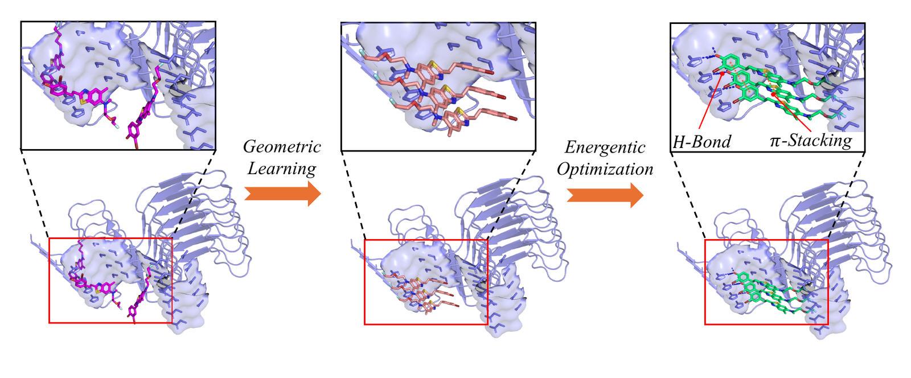
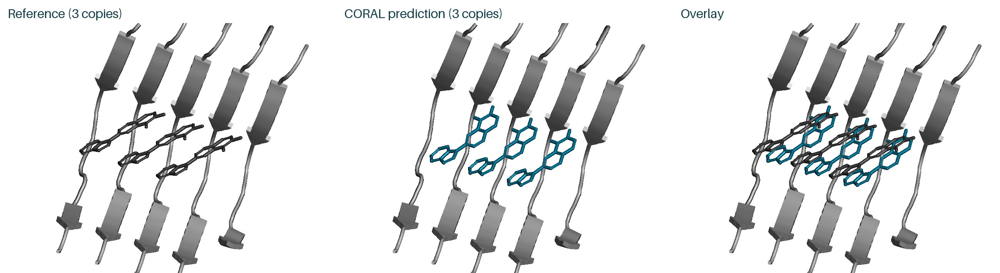
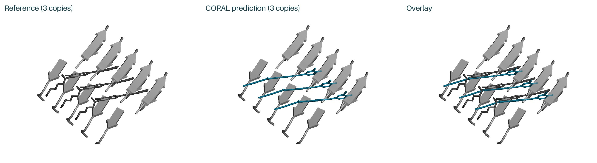
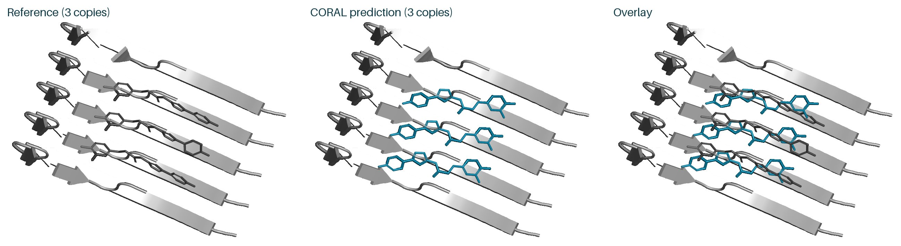
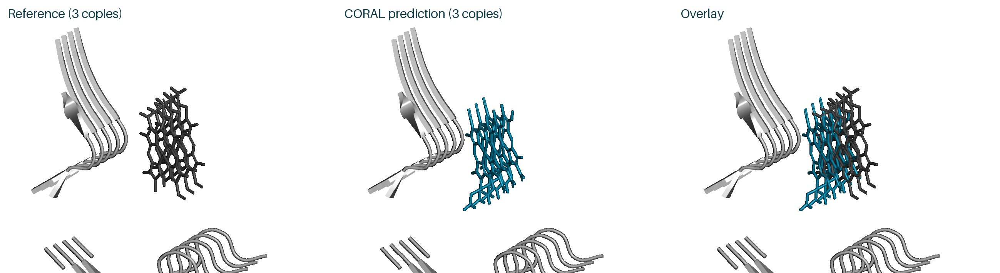
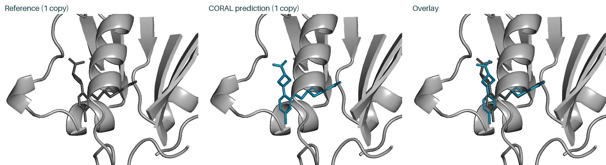
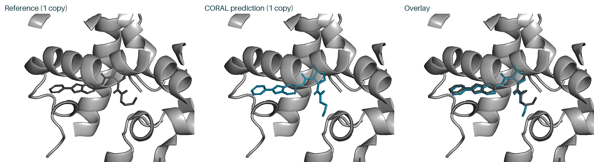

<h1 align="center">CORAL: Learning Amyloid Fibril Ligand Docking with Cooperative Binding Rewards</h1>

<p align="center">
  <b>NeurIPS 2026 · Poster</b>
</p>

<p align="center">
  Yasheng Sun<sup>1*†</sup> · Bohan Li<sup>2*</sup> · Youqi Tao<sup>3†</sup> · Jürgen Schmidhuber<sup>1</sup>
  <br>
  <sup>1</sup>Center of Excellence for Generative AI, KAUST
  <br>
  <sup>2</sup>Department of Biomedical Engineering, National University of Singapore
  <br>
  <sup>3</sup>Stern Laboratory, Brigham and Women's Hospital, Harvard University
  <br>
  <sub><sup>*</sup>Equal contribution · <sup>†</sup>Corresponding authors</sub>
</p>

<p align="center">
  <a href="https://arxiv.org/abs/2607.17412"></a>
  <a href="https://sunyasheng.github.io/projects/CORAL.html"></a>
  <a href="https://huggingface.co/papers/2607.17412"></a>
  <a href="assets/poster/coral_poster_print.pdf"></a>
  <a href="https://github.com/sunyasheng/CORAL/releases/tag/inference-v0.1.1"></a>
  <a href="inference/LICENSE"></a>
  
  
</p>

<p align="center">
  <a href="#-overview">Overview</a> ·
  <a href="#-quick-start">Quick start</a> ·
  <a href="#-run-inference">Run</a> ·
  <a href="#-outputs">Outputs</a> ·
  <a href="#-example-predictions">Examples</a> ·
  <a href="#-repository-layout">Layout</a> ·
  <a href="#-citation">Citation</a>
</p>

---

## 💡 Overview

CORAL trains a generative docking model for the repeating grooves of amyloid fibrils. Geometric warm-up establishes a ligand-stacking prior, followed by online reinforcement learning with cooperative binding rewards.

<p align="center">
  
  <br>
  <em>Geometric learning establishes ligand stacking; cooperative binding rewards then refine interactions such as hydrogen bonds and π-stacking.</em>
</p>

This repository provides inference code for the released CORAL checkpoint, `coral_rl_train.pt`. One checkpoint runs in two modes:

| | 🧬 Fibril docking | 🧪 Protein–ligand prediction with MSA |
| --- | --- | --- |
| Flag | `--mode fibril` | `--mode posebusters` |
| Predicts | Poses of several ligand copies in a supplied fibril receptor | Protein and ligand structure together |
| Receptor | Your PDB plus `receptor.refmap.json`; mapped, resolved protein atoms stay fixed | Not used |
| Protein input | Sequence with protofilament and layer label per copy | Sequence with precomputed MSA (A3M) |
| Ligand input | CCD code or SMILES, one or more copies | CCD code or SMILES, one copy |
| Optional hints | Pocket and contact constraints | None |
| Structure output | Complex `.cif` | Complex `.pdb` plus ligand `.sdf` |

## 🚀 Quick start

**Requirements:** Linux, an NVIDIA Ampere or newer GPU, the CUDA 12.x toolkit with `nvcc`, a C++ compiler and Python 3.11. We tested on H100 and H200 GPUs. Memory use depends on complex size.

```bash
git clone https://github.com/sunyasheng/CORAL.git
cd CORAL/inference
python3.11 -m venv .venv
source .venv/bin/activate
python -m pip install torch==2.7.1 --index-url https://download.pytorch.org/whl/cu126
python -m pip install -r requirements-lock.txt
python download_assets.py
```

`download_assets.py` downloads **2.10 GB** from the [`inference-v0.1.1` release](https://github.com/sunyasheng/CORAL/releases/tag/inference-v0.1.1), verifies SHA-256 and skips files that already match:

| File | Destination | Size |
| --- | --- | ---: |
| CORAL checkpoint | `checkpoints/coral_rl_train.pt` | 1.47 GB |
| Chemical Component Dictionary (CCD) | `data/components.cif` | 0.49 GB |
| RDKit cache of the CCD | `data/components.cif.rdkit_mol.pkl` | 0.14 GB |

> [!NOTE]
> The first run compiles a LayerNorm CUDA kernel. Let it finish before you start parallel runs from the same checkout. See [troubleshooting](inference/README.md#install-and-download) if a run stops during compilation.

## 🧪 Run inference

Run each command from `CORAL/inference` with the virtual environment active. Each command uses an example that ships with the repository.

### Mode 1 · Fibril docking

Dock three ligand copies into a supplied fibril receptor (example `8UQ7_g1`):

```bash
python infer.py --mode fibril \
  --input examples/fibril/8UQ7_g1/input.json \
  --receptor examples/fibril/8UQ7_g1/receptor.pdb \
  --out outputs/8UQ7_g1
```

- `input.json` gives the protein sequence, the ligand, the copy counts and the protofilament and layer labels. This example also gives pocket and contact hints. Such hints are optional.
- `receptor.pdb` needs an adjacent `receptor.refmap.json` that maps input residues to PDB residues.
- This mode does not use MSA.

### Mode 2 · Protein–ligand prediction with MSA

Predict the protein and the ligand together from sequence, ligand identity and a precomputed MSA (example `5SD5_HWI`):

```bash
python infer.py --mode posebusters \
  --input examples/posebusters/5SD5_HWI/input.json \
  --out outputs/5SD5_HWI
```

- `input.json` gives the protein sequence, one ligand and the MSA directory. MSA paths resolve relative to the JSON file. The example ships its A3M files.
- This mode takes no receptor, ligand pose, pockets or protofilament and layer labels.
- The mode name refers to the PoseBusters input format. This command does not run MSA search or PoseBusters scoring. Run those steps separately.

> [!TIP]
> Add `--check-only` to validate your input before the model loads. The full input format is in the [inference guide](inference/README.md#your-inputs-and-outputs).

### Options

| Option | Default | Meaning |
| --- | --- | --- |
| `--seed` | `101` | Random seed |
| `--samples` | `5` | Number of candidates |
| `--steps` | `200` | Diffusion steps |
| `--cycles` | `10` | Recycling cycles |
| `--workers` | `16` | Data-loader workers |
| `--kernels` | `optimized` | Use `torch` for PyTorch CUDA kernels instead of fused kernels |
| `--checkpoint` | `checkpoints/coral_rl_train.pt` | Checkpoint file |
| `--out` | required | Output directory; it must be new or empty |

## 📂 Outputs

Each run writes this structure. The fibril example is shown:

```text
outputs/8UQ7_g1/
├── run.json                  # settings, asset hashes, output checks, status
├── run.log
├── resolved_input.json
└── 8UQ7_g1/seed_101/predictions/
    ├── 8UQ7_g1_sample_0.cif                      # highest-confidence candidate
    ├── 8UQ7_g1_summary_confidence_sample_0.json  # its confidence scores
    └── ...                                       # sample_1 to sample_4
```

| | Fibril docking | Protein–ligand prediction |
| --- | --- | --- |
| Complex | `<name>_sample_<k>.cif` | `<name>_sample_<k>.pdb` |
| Ligand | Inside the CIF | `<name>_ligand_sample_<k>.sdf`; `<name>_ligand.sdf` is a copy of `sample_0` |
| Confidence | `<name>_summary_confidence_sample_<k>.json` | `<name>_summary_confidence_sample_<k>.json` |

- `<k>` ranks candidates by confidence. `sample_0` is the highest-confidence candidate.
- Fibril outputs use a receptor-centered frame. Align the output protein to the input receptor before you overlay them.
- A complete run confirms readable, finite outputs and correct atom correspondence. It does not confirm binding accuracy or physical validity. Coordinates can vary with GPU, kernel and seed.

## 🔬 Example predictions

Actual GPU outputs of the example commands with the default settings. Each PyMOL render shows the <b>gray reference</b>, the <b>teal CORAL prediction</b> (`sample_0`) and their overlay. Click an image to open the case with its input, structure and confidence files.

**Fibril docking · three ligand copies each**

<table>
  <tr>
    <td width="50%" align="center">
      <a href="inference/examples/README.md#8uq7_g1"></a>
      <br><sub><b>8UQ7_g1</b> · ligand X6R</sub>
    </td>
    <td width="50%" align="center">
      <a href="inference/examples/README.md#7wmm_g1"></a>
      <br><sub><b>7WMM_g1</b> · ligand 1KI</sub>
    </td>
  </tr>
  <tr>
    <td width="50%" align="center">
      <a href="inference/examples/README.md#9o4b_g1"></a>
      <br><sub><b>9O4B_g1</b> · ligand A1B9H</sub>
    </td>
    <td width="50%" align="center">
      <a href="inference/examples/README.md#7ynf_g2"></a>
      <br><sub><b>7YNF_g2</b> · ligand V79</sub>
    </td>
  </tr>
</table>

**Protein–ligand prediction with MSA · one ligand each**

<table>
  <tr>
    <td width="50%" align="center">
      <a href="inference/examples/README.md#5sd5_hwi"></a>
      <br><sub><b>5SD5_HWI</b> · ligand HWI</sub>
    </td>
    <td width="50%" align="center">
      <a href="inference/examples/README.md#5sis_jsm"></a>
      <br><sub><b>5SIS_JSM</b> · ligand JSM</sub>
    </td>
  </tr>
</table>

The renders align by protein only. Downloaded structures keep their original coordinates, without ligand fitting or relaxation. The 7WMM_g1 and 7YNF_g2 references include neighboring ligand copies generated by fibril symmetry. These selected examples illustrate the outputs. They are not a benchmark. Case notes, ligand-only views and per-case commands are in the **[example gallery](inference/examples/README.md)**.

## 📦 Repository layout

| Path | Contents |
| --- | --- |
| [`inference/`](inference/) | `infer.py`, `download_assets.py`, pinned requirements and the vendored model code. See the [inference guide](inference/README.md) for the input format |
| [`inference/examples/`](inference/examples/) | Six example inputs, `sample_0` outputs and PyMOL renders |
| [`assets/figures/`](assets/figures/) | Overview, architecture and qualitative comparison; original PDF figures and web previews |
| [`assets/poster/`](assets/poster/) | 140 × 90 cm landscape poster PDF, JPEG preview and online PNG |
| [`assets/videos/`](assets/videos/) | Eight molecular dynamics visualization clips and their preview images |

The simulation clips retain their original structure and system identifiers. They illustrate candidate ligand-stack trajectories. File sizes and SHA-256 checksums of the visual materials are in [`assets/manifest.json`](assets/manifest.json).

## 📝 Citation

```bibtex
@inproceedings{sun2026coral,
  title     = {{CORAL}: Learning Amyloid Fibril Ligand Docking with Cooperative Binding Rewards},
  author    = {Sun, Yasheng and Li, Bohan and Tao, Youqi and Schmidhuber, J{\"u}rgen},
  booktitle = {Advances in Neural Information Processing Systems},
  year      = {2026},
  url       = {https://neurips.cc/virtual/2026/loc/sydney/poster/154426}
}
```

The same entry is available as [`citation.bib`](citation.bib).

## 🙏 Acknowledgments and license

The inference runtime is adapted from [Protenix](https://github.com/bytedance/Protenix). CCD data comes from the [wwPDB](https://www.wwpdb.org/data/ccd). The inference code and the CORAL checkpoint are released under Apache-2.0. See [`inference/LICENSE`](inference/LICENSE) and [`inference/NOTICE`](inference/NOTICE) for upstream and data attribution.
