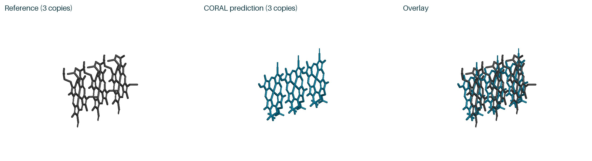

# CORAL

**Learning Amyloid Fibril Ligand Docking with Cooperative Binding Rewards**<br>
**NeurIPS 2026 · Poster**

[Project page](https://sunyasheng.github.io/projects/CORAL.html) · [Paper](https://arxiv.org/abs/2607.17412) · [Hugging Face](https://huggingface.co/papers/2607.17412) · [Poster PDF](assets/poster/coral_poster_print.pdf)

Yasheng Sun<sup>1*†</sup>, Bohan Li<sup>2*</sup>, Youqi Tao<sup>3†</sup>, Jürgen Schmidhuber<sup>1</sup>

<sup>1</sup>Center of Excellence for Generative AI, KAUST<br>
<sup>2</sup>Department of Biomedical Engineering, National University of Singapore<br>
<sup>3</sup>Stern Laboratory, Brigham and Women's Hospital, Harvard University

<sup>*</sup>Equal contribution. <sup>†</sup>Corresponding authors.


CORAL trains a generative docking model for the repeating grooves of amyloid fibrils. Geometric warm-up establishes a ligand-stacking prior, followed by online reinforcement learning with cooperative binding rewards.

## Inference

The [inference package](inference/) supports **fibril–ligand docking**
and **blind protein–ligand prediction with MSA**, using the mix3 step-19999
checkpoint with PF/layer position encoding.

[Install and run](inference/README.md) · [Sample inputs, outputs and commands](inference/examples/README.md) · [Download checkpoint and CCD](https://github.com/sunyasheng/CORAL/releases/tag/inference-v0.1.0)

### Sample predictions

Actual highest-confidence outputs from five candidates with seed 101. PyMOL renders show
gray reference, teal CORAL prediction, and their overlay. The gray protein shows the local reference
environment; blind outputs use protein-only alignment for display. Reference stacks for
7WMM and 7YNF include symmetry-derived neighboring ligand copies.

**8UQ7_g1 — three-ligand fibril stack**


**7WMM_g1 — three-ligand fibril stack**


**9O4B_g1 — three-ligand fibril stack**


**7YNF_g2 — three-ligand fibril stack**


The ligand-only view separates the three copies:



**5SD5_HWI — protein–ligand prediction with MSA**


**5SIS_JSM — protein–ligand prediction with MSA**


[Open all examples, ligand-only views, and downloadable structures](inference/examples/README.md).

## Assets

This repository contains the visual materials accompanying the project page.

| Directory | Contents |
| --- | --- |
| [`assets/figures/`](assets/figures/) | Overview, architecture, and qualitative comparison; original PDF figures and web previews |
| [`assets/poster/`](assets/poster/) | 140 × 90 cm landscape poster PDF, JPEG preview, and online PNG |
| [`assets/videos/`](assets/videos/) | Eight molecular dynamics visualization clips and their preview images |

The simulation clips retain their original structure and system identifiers. They illustrate candidate ligand-stack trajectories. File sizes and SHA-256 checksums are listed in [`assets/manifest.json`](assets/manifest.json).

The visual materials remain available at their existing paths.

## Citation

```bibtex
@inproceedings{sun2026coral,
  title     = {{CORAL}: Learning Amyloid Fibril Ligand Docking with Cooperative Binding Rewards},
  author    = {Sun, Yasheng and Li, Bohan and Tao, Youqi and Schmidhuber, J{\"u}rgen},
  booktitle = {Advances in Neural Information Processing Systems},
  year      = {2026},
  url       = {https://neurips.cc/virtual/2026/loc/sydney/poster/154426}
}
```

The same entry is available as [`citation.bib`](citation.bib).
