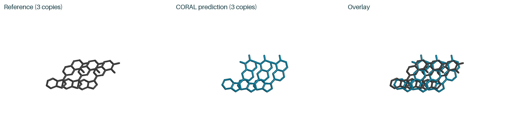
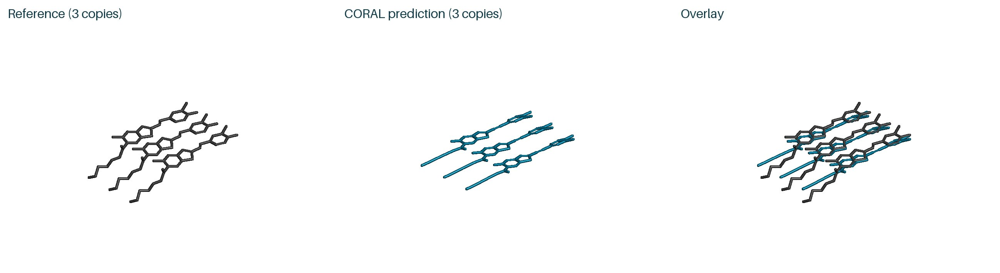
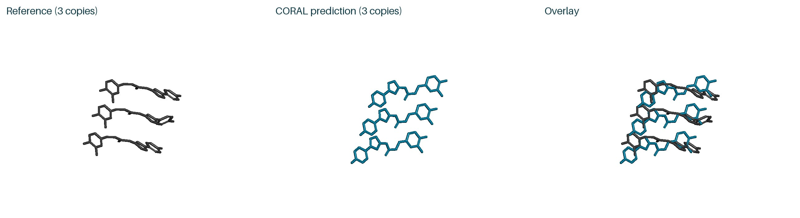
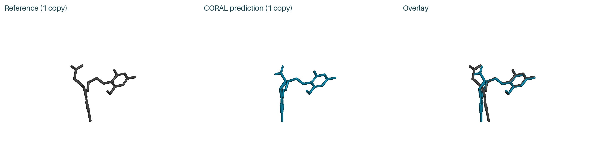
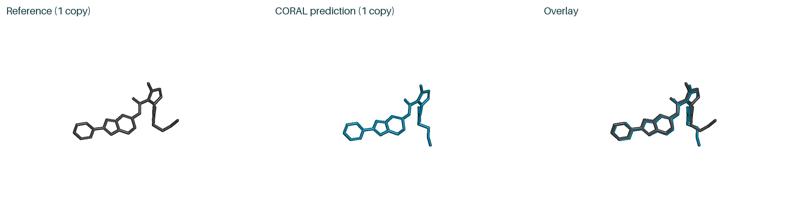

# CORAL prediction examples

Four amyloid fibril examples with three ligand copies each, followed by two protein–ligand examples.

These are actual checkpoint outputs: seed **101**, **5** candidates, **200** diffusion steps and **10** cycles. The images and downloadable structures show the highest-confidence candidate, `sample_0`.

Each PyMOL comparison shows **gray reference**, **teal CORAL prediction**, and **overlay**. The gray protein is a cropped view of the local reference environment. Blind predictions are aligned using the protein only; the downloadable outputs retain their original coordinates. No ligand fitting or relaxation is applied. These selected examples illustrate the outputs; they are not an aggregate benchmark.

Run commands below from `inference/` after [installation and asset download](../README.md#install-and-download).

## 8UQ7_g1 — three-ligand fibril stack


[Input](fibril/8UQ7_g1/input.json) · [Structure](fibril/8UQ7_g1/result/8UQ7_g1_sample_0.cif) · [Confidence](fibril/8UQ7_g1/result/8UQ7_g1_summary_confidence_sample_0.json) · [Run details](fibril/8UQ7_g1/result/metadata.json)

```bash
python infer.py --mode fibril --input examples/fibril/8UQ7_g1/input.json --receptor examples/fibril/8UQ7_g1/receptor.pdb --out outputs/8UQ7_g1
```

<details>
<summary>Ligand-only and alternative views</summary>



[Alternative protein view](fibril/8UQ7_g1/result/protein_view1.jpg) · [Alternative ligand-only view](fibril/8UQ7_g1/result/ligand_view1.jpg)

</details>

## 7WMM_g1 — three-ligand fibril stack


[Input](fibril/7WMM_g1/input.json) · [Structure](fibril/7WMM_g1/result/7WMM_g1_sample_0.cif) · [Confidence](fibril/7WMM_g1/result/7WMM_g1_summary_confidence_sample_0.json) · [Run details](fibril/7WMM_g1/result/metadata.json)

```bash
python infer.py --mode fibril --input examples/fibril/7WMM_g1/input.json --receptor examples/fibril/7WMM_g1/receptor.pdb --out outputs/7WMM_g1
```

<details>
<summary>Ligand-only and alternative views</summary>



[Alternative protein view](fibril/7WMM_g1/result/protein_view1.jpg) · [Alternative ligand-only view](fibril/7WMM_g1/result/ligand_view1.jpg)

</details>

The gray reference stack includes two neighboring copies generated by fibril symmetry around the deposited ligand.

This unrelaxed prediction has bond-length distortions in the flexible ligand tail; the raw output and render retain them.

## 9O4B_g1 — three-ligand fibril stack


[Input](fibril/9O4B_g1/input.json) · [Structure](fibril/9O4B_g1/result/9O4B_g1_sample_0.cif) · [Confidence](fibril/9O4B_g1/result/9O4B_g1_summary_confidence_sample_0.json) · [Run details](fibril/9O4B_g1/result/metadata.json)

```bash
python infer.py --mode fibril --input examples/fibril/9O4B_g1/input.json --receptor examples/fibril/9O4B_g1/receptor.pdb --out outputs/9O4B_g1
```

<details>
<summary>Ligand-only and alternative views</summary>



[Alternative protein view](fibril/9O4B_g1/result/protein_view1.jpg) · [Alternative ligand-only view](fibril/9O4B_g1/result/ligand_view1.jpg)

</details>

## 7YNF_g2 — three-ligand fibril stack


[Input](fibril/7YNF_g2/input.json) · [Structure](fibril/7YNF_g2/result/7YNF_g2_sample_0.cif) · [Confidence](fibril/7YNF_g2/result/7YNF_g2_summary_confidence_sample_0.json) · [Run details](fibril/7YNF_g2/result/metadata.json)

```bash
python infer.py --mode fibril --input examples/fibril/7YNF_g2/input.json --receptor examples/fibril/7YNF_g2/receptor.pdb --out outputs/7YNF_g2
```

<details>
<summary>Ligand-only and alternative views</summary>


[Alternative protein view](fibril/7YNF_g2/result/protein_view0.jpg) · [Alternative ligand-only view](fibril/7YNF_g2/result/ligand_view1.jpg)

</details>

The gray reference stack includes two neighboring copies generated by fibril symmetry around the deposited ligand.

## 5SD5_HWI — protein–ligand prediction with MSA


[Input](posebusters/5SD5_HWI/input.json) · [Structure](posebusters/5SD5_HWI/result/5SD5_HWI_sample_0.pdb) · [Ligand SDF](posebusters/5SD5_HWI/result/5SD5_HWI_ligand_sample_0.sdf) · [Confidence](posebusters/5SD5_HWI/result/5SD5_HWI_summary_confidence_sample_0.json) · [Run details](posebusters/5SD5_HWI/result/metadata.json)

```bash
python infer.py --mode posebusters --input examples/posebusters/5SD5_HWI/input.json --out outputs/5SD5_HWI
```

<details>
<summary>Ligand-only and alternative views</summary>



[Alternative protein view](posebusters/5SD5_HWI/result/protein_view1.jpg) · [Alternative ligand-only view](posebusters/5SD5_HWI/result/ligand_view1.jpg)

</details>

## 5SIS_JSM — protein–ligand prediction with MSA


[Input](posebusters/5SIS_JSM/input.json) · [Structure](posebusters/5SIS_JSM/result/5SIS_JSM_sample_0.pdb) · [Ligand SDF](posebusters/5SIS_JSM/result/5SIS_JSM_ligand_sample_0.sdf) · [Confidence](posebusters/5SIS_JSM/result/5SIS_JSM_summary_confidence_sample_0.json) · [Run details](posebusters/5SIS_JSM/result/metadata.json)

```bash
python infer.py --mode posebusters --input examples/posebusters/5SIS_JSM/input.json --out outputs/5SIS_JSM
```

<details>
<summary>Ligand-only and alternative views</summary>



[Alternative protein view](posebusters/5SIS_JSM/result/protein_view1.jpg) · [Alternative ligand-only view](posebusters/5SIS_JSM/result/ligand_view1.jpg)

</details>

Fibril inputs include a supplied receptor, residue mapping and pocket/contact hints. Blind-mode inputs contain sequence, ligand identity and real precomputed MSA; references are used only after prediction for these comparisons.
